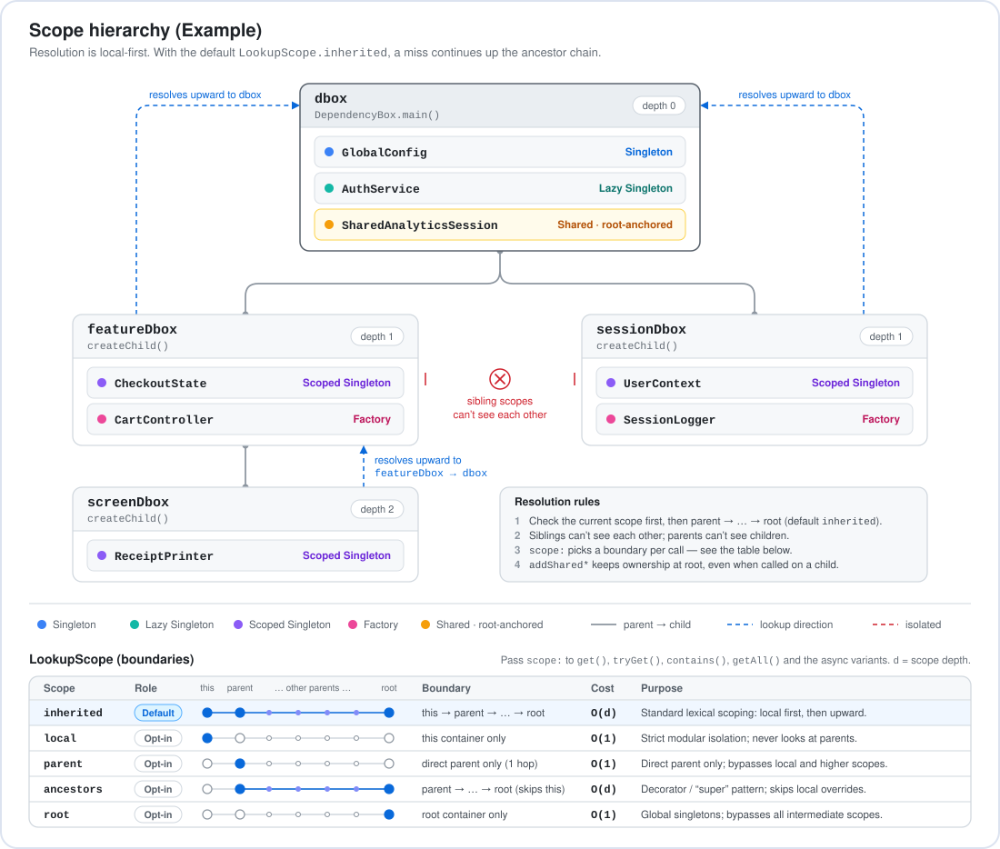
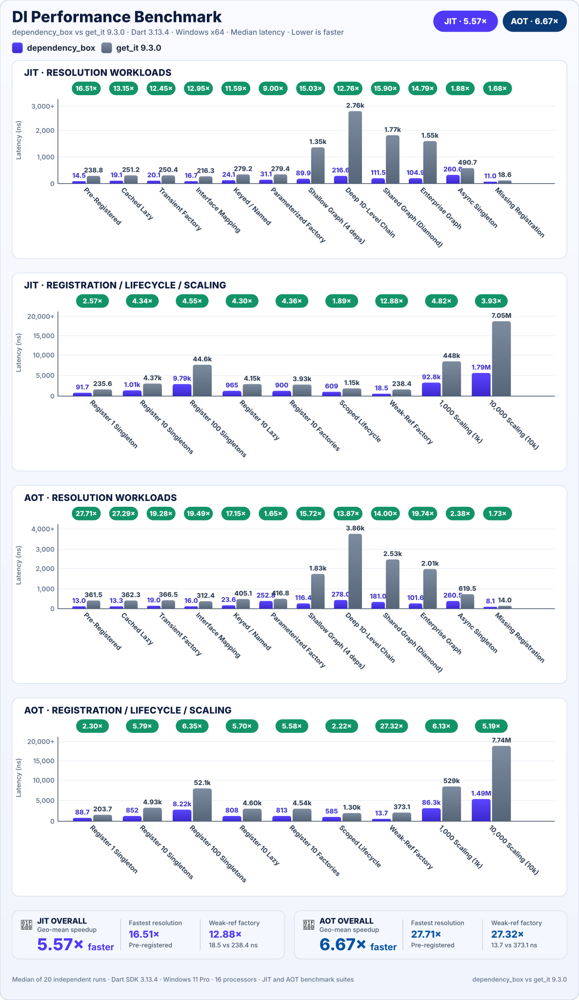

# dependency_box

[](https://pub.dev/packages/dependency_box)
[](https://github.com/ahmedm-gh/dart-packages)
[](https://github.com/ahmedm-gh)
[](https://github.com/sponsors/ahmedm-gh)
[](https://opensource.org/licenses/MIT)

A high-performance, lightweight, zero-dependency Inversion-of-Control (IoC) container and service locator for Dart and Flutter applications.

Engineered with a zero-allocation unkeyed lookup path, `dependency_box` achieves sub-15ns resolution latency while offering hierarchical child scopes, lock-free async initialization deduplication, circular dependency detection, and deterministic lifecycle management.

---

## ✨ Features

- 🎯 **Zero-Boilerplate Type Inference**: Inferred registrations and resolutions without typing `<Type>` angle brackets.
- 🪶 **Zero Runtime Dependencies**: Pure Dart code compatible with Flutter, VM, Web, and WebAssembly (WASM).
- ⚡ **Sub-15ns Resolution**: Over 75 Million ops/sec on the hot path via direct `Type` literal map keys.
- ⏳ **6 Registration Lifetimes**: Eager singletons, lazy singletons, weak-reference caches, transient factories, parameterized factories, and async singletons.
- 🌳 **Hierarchical Child Scopes**: Isolated sub-containers (`createChild()`) that inherit parent registrations.
- 🔍 **Hierarchy Resolution Boundaries (`LookupScope`)**: Pinpoint search boundaries (`inherited`, `local`, `parent`, `ancestors`, `root`) with zero allocation overhead.
- 📐 **Hierarchy Introspection**: Query container `depth`, identify registration owners via `findOwner<T>()`, and detect shadowed bindings via `isShadowed<T>()`.
- 🌐 **Root-Anchored Shared Singletons**: Register singletons from child scopes (`addShared*`) anchored directly to root.
- 🔄 **Async Concurrency & Cycle Detection**: In-flight `Future` deduplication with automatic reentrancy/circular dependency protection.
- 🧹 **Automatic Resource Disposal**: Clean lifecycle cleanup via `DependencyDisposable` and inline `onDispose` hooks.

---

## 📦 Getting Started

Add `dependency_box` to your `pubspec.yaml`:

```bash
dart pub add dependency_box
```

or for Flutter

```bash
flutter pub add dependency_box
```

Import the package:

```dart
import 'package:dependency_box/dependency_box.dart';
```

---

## 🚀 Quick Start: Zero `<Type>` Boilerplate

Unlike traditional service locators where you repeat class names in angle brackets (`<Config>`, `<Client>`, `<Repository>`), `dependency_box` leverages bidirectional type inference to deduce types automatically from instances, closures, and variable declarations:

```dart
import 'package:dependency_box/dependency_box.dart';

class ApiConfig {
  const ApiConfig(this.baseUrl);
  final String baseUrl;
}

class ApiClient {
  ApiClient(this.config);
  final ApiConfig config;
}

class UserRepository {
  UserRepository(this.client);
  final ApiClient client;
  String getUser(String id) => 'User $id from ${client.config.baseUrl}';
}

// Root Container (creates the primary container instance)
final dbox = DependencyBox.main();

void main() {
  // 1. Inferred Registrations: No <Type> brackets needed!
  dbox.addSingleton(const ApiConfig('https://api.example.com'));
  dbox.addLazySingleton((dbox) => ApiClient(dbox.get()));
  dbox.addFactory((dbox) => UserRepository(dbox.get()));

  // 2. Inferred Resolution: Inferred from the variable type
  final UserRepository userRepo = dbox.get();
  print(userRepo.getUser('42')); // User 42 from https://api.example.com
}
```

---

## 💡 Core Usage & Lifetimes

### 1. Registration Lifetimes

```dart
// Root Container (creates the primary container instance)
final dbox = DependencyBox.main();

// Eager Singleton (instantiated immediately)
dbox.addSingleton(NotificationService());

// Lazy Singleton (instantiated once upon first get())
dbox.addLazySingleton((dbox) => AuthService(dbox.get()));

// Weak-Reference Cached Factory (cached while referenced in memory, auto-collected when unreferenced)
dbox.addCachedFactory((dbox) => ReportRenderer());

// Transient Factory (creates a fresh instance every time get() is called)
dbox.addFactory((dbox) => OrderController(dbox.get()));

// Parameterized Factory (accepts runtime arguments)
dbox.addFactoryWith<ScopedLogger, String>((dbox, tag) => ScopedLogger(tag));

// Asynchronous Singleton (deduplicated Future resolution)
dbox.addAsyncSingleton((dbox) async {
  final session = await loadRemoteSession();
  return session;
});
```

### 2. Hierarchical Child Scopes & Scoping Properties

Child scopes inherit dependencies from their parent while keeping local registrations isolated. When the child scope is disposed, its local resources are cleaned up without affecting the parent:

```dart
// Root Container (creates the primary container instance)
final dbox = DependencyBox.main(name: 'app_root');

// Eager Singleton on root
dbox.addSingleton(GlobalConfig());

// Create an isolated child scope (via convenience method)
final featureDbox = dbox.createChild(name: 'checkout_feature');

// Or create a child container (via explicit parent constructor)
final childDbox = DependencyBox.child(parent: dbox, name: 'child_scope');

// Scoped Singleton (isolated to child scope)
featureDbox.addSingleton(CheckoutState());

// Shared Singleton (anchored to root from within the child scope)
featureDbox.addSharedSingleton(SharedAnalyticsSession());

// Scope hierarchy inspection:
print(featureDbox.name); // 'checkout_feature'
print(featureDbox.parent); // dbox
print(featureDbox.root); // dbox (topmost root across any nesting depth)
print(featureDbox.depth); // 1 (0 for root, 1 for direct child)
print(dbox.children.length); // 2 active direct child scopes

// Dispose scope and clean up scoped dependencies
await featureDbox.dispose();
```

- **`createChild({String? name})`**: *Importance:* Creates an isolated sub-container (e.g. for user sessions, HTTP requests, or navigation flows) that inherits parent dependencies. When the child scope is disposed, its scoped resources are torn down without affecting the parent.
- **`children`**: *Importance:* An unmodifiable iterable of all active direct child containers tracked by this container.
- **`depth`**: *Importance:* The 0-based hierarchy depth level (`0` for root, `1` for child, `2` for grandchild, etc.).
- **`findOwner<T>({key, scope})`**: *Importance:* Returns the specific container instance in the hierarchy that holds the registration for type `T`, or `null` if not found. Useful for inspecting ownership or performing targeted singleton replacements (`findOwner<T>()?.replaceSingleton(...)`).
- **`isShadowed<T>({key})`**: *Importance:* Returns `true` if type `T` is registered locally in this container *and* also exists in an ancestor container, identifying shadow overrides.
- **`name`**: *Importance:* An optional human-readable identifier displayed in logs, error traces, and diagnostic inspection (`printContainer()`) to distinguish scopes.
- **`parent`**: *Importance:* Gives direct access to the immediate parent container (or `null` if root), enabling scope boundary inspection.
- **`root`**: *Importance:* Resolves the topmost root container across any nesting depth, ensuring direct access to global application singletons from deeply nested scopes.

#### Scope Hierarchy & Upward Resolution

Child containers resolve dependencies locally first, then seamlessly delegate missing lookups up the ancestor chain to the root container. Sibling child scopes remain completely isolated from each other:



<details>
<summary>ASCII scope hierarchy representation</summary>

```text
dbox (DependencyBox.main) [depth: 0]
├── GlobalConfig                          (Singleton)
├── AuthService                           (Lazy Singleton)
├── SharedAnalyticsSession                (Shared Singleton — anchored to root)
│
├── featureDbox (createChild) [depth: 1]
│   ├── CheckoutState                     (Scoped Singleton)
│   ├── CartController                    (Factory)
│   │   ▲
│   │   └── Resolves missing lookups upward: featureDbox ──> dbox
│   │
│   └── screenDbox (createChild) [depth: 2]
│       └── ReceiptPrinter                (Scoped Singleton)
│           ▲
│           └── Cascades upward: screenDbox ──> featureDbox ──> dbox
│
└── sessionDbox (createChild) [depth: 1]
    ├── UserContext                       (Scoped Singleton)
    └── SessionLogger                     (Factory)
        ▲
        └── Isolated from sibling featureDbox; resolves inherited from dbox
```

</details>

#### Hierarchy Resolution Boundaries (`LookupScope`)

By default, resolution checks the local container first and cascades upward through ancestors to the root container (`LookupScope.inherited`). When precise control over resolution boundaries is required, pass `scope` to `get()`, `tryGet()`, `getAsync()`, `tryGetAsync()`, `contains()`, `getAll()`, or `getAllAsync()`:

| `LookupScope` | Role | Resolution Boundary | Complexity | Purpose & Typical Use Case |
| :--- | :---: | :--- | :---: | :--- |
| **`inherited`** | **Default** | `this` → `parent` → ... → `root` | `O(d)` | Standard lexical scoping: resolves locally first, cascading upward. |
| **`local`** | Opt-in | `this` container only | `O(1)` | Strict modular isolation: ensures instance exists directly in this container without looking up parents. |
| **`parent`** | Opt-in | Immediate direct `parent` only (1 hop) | `O(1)` | Accesses the direct parent container, bypassing local overrides and higher ancestors. |
| **`ancestors`** | Opt-in | `parent` → ... → `root` (skips `this`) | `O(d)` | Decorator / "super" pattern: accesses inherited services while intentionally skipping local overrides. |
| **`root`** | Opt-in | `root` container only | `O(1)` | Direct pointer jump: resolves global application singletons, bypassing all intermediate scopes. |

##### Example: Scope Boundary Control & Shadow Detection

```dart
// Root Container (creates the primary container instance)
final dbox = DependencyBox.main(name: 'app_root');
dbox.addSingleton<ApiClient>(ProductionApiClient());

// Child and Grandchild Scopes
final featureDbox = dbox.createChild(name: 'checkout_feature');
final screenDbox = featureDbox.createChild(name: 'payment_screen');

// Scoped override in screenDbox (shadows root)
screenDbox.addSingleton<ApiClient>(MockApiClient());

// 1. inherited (default): finds the nearest registration in screenDbox
final client1 = screenDbox.get<ApiClient>(); // MockApiClient

// 2. local: resolves strictly within screenDbox
final client2 = screenDbox.get<ApiClient>(scope: LookupScope.local); // MockApiClient

// 3. ancestors: skips screenDbox and resolves from ancestors
final client3 = screenDbox.get<ApiClient>(scope: LookupScope.ancestors); // ProductionApiClient

// 4. root: jumps directly to root container in O(1)
final client4 = screenDbox.get<ApiClient>(scope: LookupScope.root); // ProductionApiClient

// 5. parent: searches strictly within featureDbox (not found -> null)
final parentClient = screenDbox.tryGet<ApiClient>(scope: LookupScope.parent); // null

// Hierarchy Introspection & Shadow Detection
print(screenDbox.depth); // 2
print(screenDbox.isShadowed<ApiClient>()); // true (screenDbox shadows root ApiClient)
print(screenDbox.findOwner<ApiClient>()?.name); // 'payment_screen'
print(screenDbox.findOwner<ApiClient>(scope: LookupScope.root)?.name); // 'app_root'
```

#### Child Self-Detachment vs. Cascading Parent Disposal

Disposing an individual child cleanly tears down its local scope and descendants while leaving parents and siblings intact. Disposing a parent cascades downward to all descendants before finalizing local resources:

```text
1. Disposing Individual Child (await childDbox.dispose())
   │
   ├── [1] Descendant Teardown ──> Recursively disposes all active sub-scopes (e.g. screenDbox)
   ├── [2] Local Cleanup       ──> Disposes local instances & active DependencyDisposables
   ├── [3] Self-Detachment     ──> Detaches itself from parent's children collection
   │                               (sets parent._children = null when final child exits)
   └── [4] Parent Isolation    ──> Parent and sibling containers remain active and untouched

2. Cascading Parent Disposal (await rootDbox.dispose())
   │
   ├── [1] Pre-emptive Transfer ──> Snapshots children and clears parent._children reference
   │                               (prevents ConcurrentModificationError during iteration)
   ├── [2] Downward Cascade    ──> Recursively awaits dispose() on all active child scopes
   ├── [3] Fault Tolerance    ──> Continues tearing down remaining children if one throws
   ├── [4] Ancestor Detach     ──> Detaches parent from grandparent (if intermediate scope)
   ├── [5] Local Cleanup       ──> Disposes parent's own singletons, instances, and disposables
   └── [6] Error Propagation   ──> Re-throws first encountered child or local disposal error
```

### 3. Lifecycle Cleanup with `DependencyDisposable`

Classes implementing `DependencyDisposable` or registered with custom `onDispose` hooks are automatically closed when their container is disposed:

```dart
class EventBusService implements DependencyDisposable {
  final _controller = StreamController<String>.broadcast();

  Stream<String> get stream => _controller.stream;
  void publish(String event) => _controller.add(event);

  @override
  void dispose() {
    _controller.close();
    print('EventBusService streams closed cleanly.');
  }
}

// Automatically called when dbox.dispose() is executed
dbox.addSingleton(EventBusService());

// Or with an inline hook for third-party classes:
dbox.addSingleton(
  StreamController<String>.broadcast(),
  onDispose: (controller) => controller.close(),
);
```

- **`DependencyDisposable`**: *Importance:* Standard lifecycle contract (`FutureOr<void> dispose()`). When a container is disposed or a dependency is removed, `DependencyBox` automatically invokes `dispose()` on any active registered instance implementing this interface.

### 4. Modular Feature Registration (`install` & `installAll`)

Package related registrations into cohesive modules implementing `DependencyModule`:

```dart
class NetworkModule implements DependencyModule {
  @override
  void register(DependencyBox dbox) {
    dbox.addSingleton(HttpClient());
    dbox.addLazySingleton((dbox) => ApiService(dbox.get()));
  }
}

class AuthModule implements DependencyModule {
  @override
  void register(DependencyBox dbox) {
    dbox.addSingleton(AuthTokenProvider());
  }
}

// Root Container (creates the primary container instance)
final dbox = DependencyBox.main();

// Install a single module:
dbox.install(NetworkModule());

// Or batch-install multiple modules at the composition root:
dbox.installAll([NetworkModule(), AuthModule()]);
```

- **`DependencyModule`**: *Importance:* Modular feature registration contract (`void register(DependencyBox dbox)`). Encapsulates related dependencies into cohesive, reusable architectural units.
- **`install(module)`**: *Importance:* Enables modular, decoupled architecture by organizing feature dependencies into dedicated classes rather than maintaining a monolithic composition root.
- **`installAll(modules)`**: *Importance:* Streamlines application startup sequences by cleanly registering multiple feature modules in a single call.

### 5. Multi-Registrations (`allowMulti` & `allowMultiAll`)

By default, duplicate registrations throw an assertion to catch accidental overwrites. When multiple implementations of a type are intentionally needed (e.g. plugins, interceptors, middleware), enable multi-registration:

```dart
abstract interface class Interceptor {
  void intercept(String request);
}

// Root Container (creates the primary container instance)
final dbox = DependencyBox.main();

// 1. Enable multiple registrations for a type with a resolution strategy
dbox.allowMulti<Interceptor>(resolution: MultiResolution.last);

// Register multiple implementations of the same type
dbox.addSingleton<Interceptor>(AuthInterceptor());
dbox.addSingleton<Interceptor>(LoggingInterceptor());

// 2. Resolve all instances or the default instance
final List<Interceptor> all = dbox.getAll<Interceptor>().toList();
final Interceptor active = dbox.get(); // Resolves LoggingInterceptor (last)

// 3. Or batch-configure multiple types at once:
dbox.allowMultiAll({
  const MultiRegistration<Interceptor>.last(),
  const MultiRegistration<Validator>(),
});
```

- **`allowMulti<T>({resolution})`**: *Importance:* Safely opts type `T` into multiple registrations and defines how `get<T>()` resolves (`first`, `last`, `at(index)`, `key(key)`), while `getAll<T>()` retrieves the full collection of instances.
- **`allowMultiAll(types)`**: *Importance:* Declaratively configures multi-registration for multiple types in a single call using compile-time `MultiRegistration` descriptors.

---

## ⚡ Performance

`dependency_box` is engineered around a zero-allocation unkeyed lookup path using direct `Type` literal map keys without wrapper objects or reflection layers.

### Verified Benchmark Comparison: `dependency_box` vs. `get_it 9.3.0`

`dependency_box` outperforms `get_it 9.3.0` across all 27 benchmark workloads on both Native AOT and JIT runtimes:

- **Overall Speedup**: **~1.33× to ~26.7× faster** on Native AOT and **~1.52× to ~15.3× faster** on JIT.
- **Resolution Hot Path**: Up to **~26.7× faster** on singleton, lazy, factory, and graph lookups (e.g. Singleton: 14.1 ns vs 377.2 ns in AOT; 30.2 ns vs 461.0 ns in JIT).
- **Registration & Scaling**: **~1.33× to ~8.2× faster** from 1 to 10,000 services with zero-overhead container setup.
- **Lifecycle & Scoping**: **~2.37× to ~25.8× faster** across child scopes, hierarchy resolution boundaries, and cached factories.



> [!TIP]
> **Detailed Benchmark Audit & Test Suite on GitHub**
>
> To keep the published pub package download minimal and lightweight for production builds, the comprehensive benchmark audit report (`doc/benchmarks.md`), internal benchmarking harnesses (`tool/`), and automated test suite (`test/`) are excluded from the pub.dev distribution.
>
> If you would like to inspect the complete statistical breakdown, reproduction instructions, or test suite, please visit the [GitHub repository](https://github.com/ahmedm-gh/dart-packages/tree/main/dependency_box):
>
> - 📊 **Detailed Benchmark Audit & Statistical Tables**: [doc/benchmarks.md](https://github.com/ahmedm-gh/dart-packages/blob/main/dependency_box/doc/benchmarks.md)
> - 🧪 **Comprehensive Automated Test Suite**: [test/](https://github.com/ahmedm-gh/dart-packages/tree/main/dependency_box/test)
> - 🔬 **Reproducible Benchmark Suites & Tooling**: [tool/](https://github.com/ahmedm-gh/dart-packages/tree/main/dependency_box/tool)

---

## 🛠️ Flutter DevTools Extension (Beta)

`dependency_box` provides an official, zero-overhead Flutter DevTools extension via the companion package [`dependency_box_devtools`](https://pub.dev/packages/dependency_box_devtools).

- **Registrations Table**: Search and filter registrations by type, qualifying key, lifecycle kind, and heap allocation state.
- **Scope Hierarchy Tree**: Inspect container nesting depths, direct registration counts, and disposal state.
- **Dependency Graph Viewer**: Interactive pan-and-zoom visual cluster view mapping services to their owning scopes.
- **Diagnostics & Health Audits**: Automatic detection of shadowed bindings, disposed scope leaks, and multi-registration strategies.
- **Zero Runtime Overhead**: On-demand snapshot model. Absolutely zero work or allocation is performed on hot resolution paths when DevTools is inactive.

### Quick Start

Add `dependency_box_devtools` to your `dev_dependencies`:

```yaml
dev_dependencies:
  dependency_box_devtools: ^1.0.0
```

Register your container in your app's startup code:

```dart
import 'package:dependency_box/dependency_box.dart';
import 'package:dependency_box/devtools.dart';

void main() {
  final box = DependencyBox.main(name: 'AppRoot');
  
  // Register dependencies...
  
  // Register with DevTools
  DependencyBoxDevTools.register(box);
  
  runApp(const MyApp());
}
```

For complete architecture details and benchmark overhead analysis, see [doc/devtools.md](doc/devtools.md).

---

## Supporting & Contributing

If you find `dependency_box` helpful, here are several ways you can support the project:

### 🌟 Community Support

- **Star the Repository**: Star [ahmedm-gh/dart-packages](https://github.com/ahmedm-gh/dart-packages) on GitHub to help others discover it.
- **Report Issues & Ideas**: Found a bug or need an improvement? Open an issue on [GitHub Issues](https://github.com/ahmedm-gh/dart-packages/issues).
- **Contribute**: Pull requests for optimizations, documentation, or examples are always welcome.
- **Spread the Word**: Recommend `dependency_box` in your Flutter/Dart teams, blogs, or communities.

### ☕ Sponsorship & Backing

- **Sponsor on GitHub**: If this package brings value to your commercial apps, consider supporting its maintenance via [GitHub Sponsors](https://github.com/sponsors/ahmedm-gh).
- **Buy Me a Coffee**: Support development with a one-time coffee or recurring donation via [Buy Me a Coffee](https://buymeacoffee.com/ahmeds1).

## Author & Maintainer

Created and maintained by **[AHMED M.](https://github.com/ahmedm-gh)**  

- GitHub: [@ahmedm-gh](https://github.com/ahmedm-gh)
- Repository: [ahmedm-gh/dart-packages](https://github.com/ahmedm-gh/dart-packages)

## License

This package is licensed under the [MIT License](./LICENSE).
