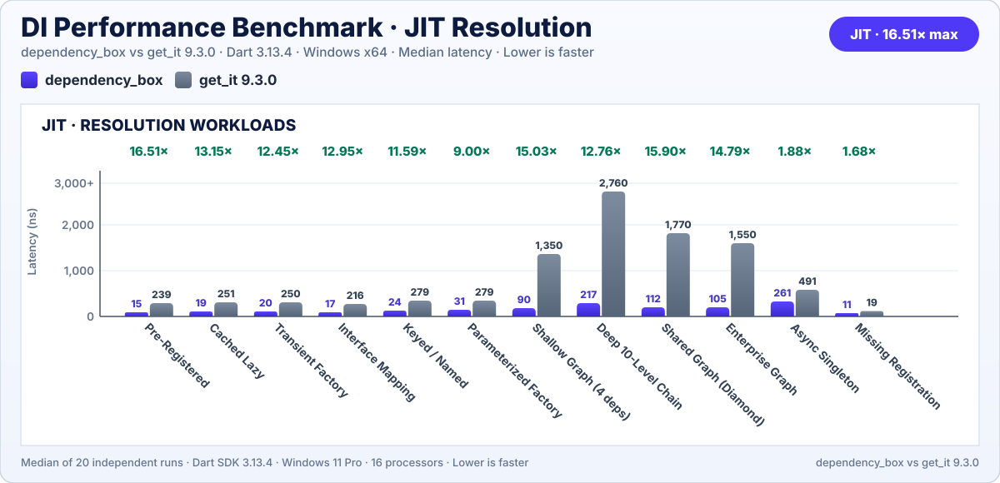
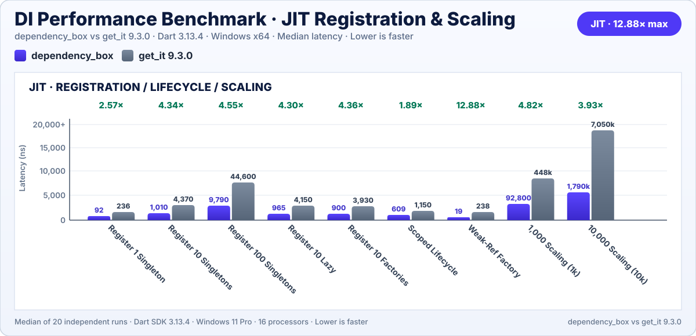
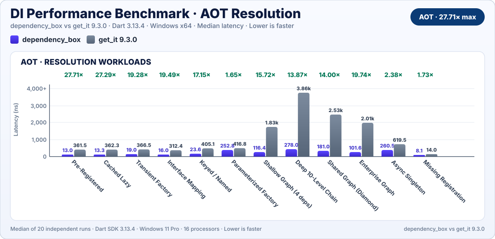
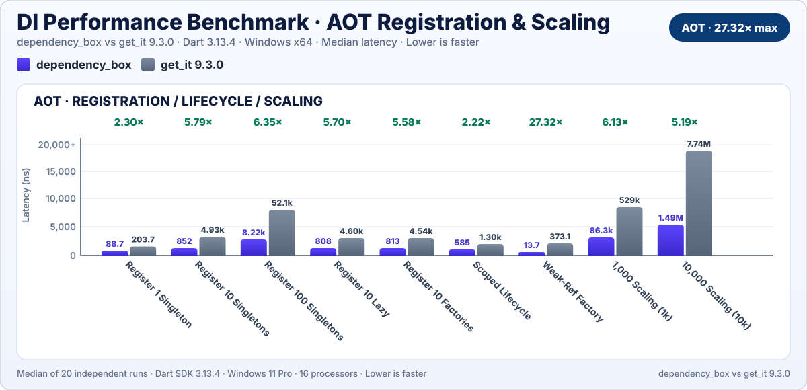

# dependency_box

[](https://pub.dev/packages/dependency_box)
[](https://github.com/ahmedm-gh/dart-packages)
[](https://github.com/ahmedm-gh)
[](https://github.com/sponsors/ahmedm-gh)
[](https://opensource.org/licenses/MIT)

A high-performance, lightweight, zero-dependency Inversion-of-Control (IoC) container and service locator for Dart and Flutter applications.

Engineered with a zero-allocation unkeyed lookup path, `dependency_box` achieves sub-15ns resolution latency while offering hierarchical child scopes, lock-free async initialization deduplication, circular dependency detection, and deterministic lifecycle management.

---

## ✨ Features

- 🎯 **Zero-Boilerplate Type Inference**: Inferred registrations and resolutions without typing `<Type>` angle brackets.
- 🪶 **Zero Runtime Dependencies**: Pure Dart code compatible with Flutter, VM, Web, and WebAssembly (WASM).
- ⚡ **Sub-15ns Resolution**: Over 75 Million ops/sec on the hot path via direct `Type` literal map keys.
- ⏳ **6 Registration Lifetimes**: Eager singletons, lazy singletons, weak-reference caches, transient factories, parameterized factories, and async singletons.
- 🌳 **Hierarchical Child Scopes**: Isolated sub-containers (`createChild()`) that inherit parent registrations.
- 🌐 **Root-Anchored Shared Singletons**: Register singletons from child scopes (`addShared*`) anchored directly to root.
- 🔄 **Async Concurrency & Cycle Detection**: In-flight `Future` deduplication with automatic reentrancy/circular dependency protection.
- 🧹 **Automatic Resource Disposal**: Clean lifecycle cleanup via `DependencyDisposable` and inline `onDispose` hooks.

---

## 📦 Getting Started

Add `dependency_box` to your `pubspec.yaml`:

```bash
dart pub add dependency_box
# or for Flutter
flutter pub add dependency_box
```

Import the package:

```dart
import 'package:dependency_box/dependency_box.dart';
```

---

## 🚀 Quick Start: Zero `<Type>` Boilerplate

Unlike traditional service locators where you repeat class names in angle brackets (`<Config>`, `<Client>`, `<Repository>`), `dependency_box` leverages bidirectional type inference to deduce types automatically from instances, closures, and variable declarations:

```dart
import 'package:dependency_box/dependency_box.dart';

class ApiConfig {
  const ApiConfig(this.baseUrl);
  final String baseUrl;
}

class ApiClient {
  ApiClient(this.config);
  final ApiConfig config;
}

class UserRepository {
  UserRepository(this.client);
  final ApiClient client;
  String getUser(String id) => 'User $id from ${client.config.baseUrl}';
}

void main() {
  final dbox = DependencyBox.main();

  // 1. Inferred Registrations: No <Type> brackets needed!
  dbox.addSingleton(const ApiConfig('https://api.example.com'));
  dbox.addLazySingleton((dbox) => ApiClient(dbox.get()));
  dbox.addFactory((dbox) => UserRepository(dbox.get()));

  // 2. Inferred Resolution: Inferred from the variable type
  final UserRepository userRepo = dbox.get();
  print(userRepo.getUser('42')); // User 42 from https://api.example.com
}
```

---

## 💡 Core Usage & Lifetimes

### 1. Registration Lifetimes

```dart
final dbox = DependencyBox.main();

// Eager Singleton (instantiated immediately)
dbox.addSingleton(DatabaseService());

// Lazy Singleton (instantiated once upon first get())
dbox.addLazySingleton((dbox) => AuthService(dbox.get()));

// Weak-Reference Cached Factory (cached while referenced in memory, auto-collected when unreferenced)
dbox.addCachedFactory((dbox) => HeavyImageCache());

// Transient Factory (creates a fresh instance every time get() is called)
dbox.addFactory((dbox) => OrderController(dbox.get()));

// Parameterized Factory (accepts runtime arguments)
dbox.addFactoryWith<QueryEngine, String>((dbox, query) => QueryEngine(query));

// Asynchronous Singleton (deduplicated Future resolution)
dbox.addAsyncSingleton((dbox) async {
  final session = await loadRemoteSession();
  return session;
});
```

### 2. Hierarchical Child Scopes & Shared Bindings

Child scopes inherit dependencies from their parent while keeping local registrations isolated. When the child scope is disposed, its local resources are cleaned up without affecting the parent:

```dart
final appBox = DependencyBox.main(name: 'app_root');
appBox.addSingleton(GlobalConfig());

// Create an isolated feature scope
final featureBox = appBox.createChild(name: 'checkout_feature');
featureBox.addSingleton(CheckoutState());

// Register a shared singleton anchored to root from within the child scope
featureBox.addSharedSingleton(SharedAnalyticsSession());

// Dispose scope and clean up scoped dependencies
featureBox.dispose();
```

### 3. Lifecycle Cleanup with `DependencyDisposable`

Classes implementing `DependencyDisposable` or registered with custom `onDispose` hooks are automatically closed when their container is disposed:

```dart
class DatabaseClient implements DependencyDisposable {
  @override
  void dispose() {
    print('Database connection closed cleanly.');
  }
}

// Automatically called when dbox.dispose() is executed
dbox.addSingleton(DatabaseClient());

// Or with an inline hook for third-party classes:
dbox.addSingleton(
  StreamController<String>.broadcast(),
  onDispose: (controller) => controller.close(),
);
```

---

## 📂 Examples

A progressive suite of 13 standalone runnable examples is available in the [`example/`](./example) directory:

- **[Basic Examples](./example/basic/)**: [Simple Registration](./example/basic/simple_registration.dart), [Interface Mapping](./example/basic/interface_mapping.dart), [Keyed Dependencies](./example/basic/keyed_dependencies.dart), [Parameterized Factory](./example/basic/parameterized_factory.dart).
- **[Intermediate Patterns](./example/intermediate/)**: [Modules & Composition](./example/intermediate/modules_and_composition.dart), [Hierarchical Scopes](./example/intermediate/hierarchical_scopes.dart), [Multi-Registrations](./example/intermediate/multi_registrations.dart), [Async Deduplication](./example/intermediate/async_and_deduplication.dart), [Weak-Reference Cache](./example/intermediate/weak_reference_cache.dart).
- **[Advanced Architectures](./example/advanced/)**: [Clean Architecture](./example/advanced/clean_architecture.dart), [Lifecycle & Disposal](./example/advanced/lifecycle_and_disposal.dart), [Testing & Overrides](./example/advanced/testing_and_overrides.dart), [Diagnostics & Debugging](./example/advanced/diagnostics_and_debugging.dart).

See [example/README.md](./example/README.md) for complete descriptions and execution instructions.

---

## ⚡ Performance

`dependency_box` is engineered around a zero-allocation unkeyed lookup path using direct `Type` literal map keys without wrapper objects or reflection layers.

### Verified Benchmark Comparison: `dependency_box` vs. `get_it 9.3.0`

- **Head-to-Head Resolution**: `dependency_box` delivers up to **27.71× faster** dependency resolution than `get_it 9.3.0` (e.g. Singleton: 13 ns vs 362 ns in AOT; 15 ns vs 239 ns in JIT).
- **Container Setup**: **2.30×–6.35× faster** initialization and dependency binding setup.
- **Complex Architectures**: **13.87×–19.74× faster** across deep dependency graphs and application lifecycles, with weak-reference caching reaching **27.32×**.
- **Verified Suite Advantage**: **5.57× geometric-mean speedup in JIT** and **6.67× in AOT** across comprehensive multi-workload benchmarking.

#### 1. JIT Resolution Workloads



#### 2. JIT Registration & Scaling



#### 3. AOT Resolution Workloads



#### 4. AOT Registration & Scaling



> [!TIP]
> A consolidated 4-in-1 chart is also available at [doc/benchmark_comparison.svg](doc/benchmark_comparison.svg), along with suite overviews for [JIT](doc/benchmark_jit.svg) and [AOT](doc/benchmark_aot.svg).

### 🔬 Reproducing the Benchmarks

All benchmark suites and measurement harnesses are 100% open source and reproducible:

- **Comparative Benchmark Suite**: [`tool/comparison_benchmark/`](https://github.com/ahmedm-gh/dart-packages/tree/main/dependency_box/tool/comparison_benchmark)

  ```bash
  # Run head-to-head microbenchmarks (dependency_box vs get_it 9.3.0)
  dart run tool/comparison_benchmark/bin/compare_benchmark.dart

  # Run real-world production architecture simulation suite
  dart run tool/comparison_benchmark/bin/real_world_benchmark.dart
  ```

- **Standalone Package Microbenchmarks**: [`tool/benchmark/`](https://github.com/ahmedm-gh/dart-packages/tree/main/dependency_box/tool/benchmark)

  ```bash
  dart run tool/benchmark/benchmark.dart
  ```

> [!NOTE]
>
> - Benchmarks were run on Dart SDK 3.13.4 on Windows x64.
> - Comparison harness sources are located in [`tool/comparison_benchmark/`](https://github.com/ahmedm-gh/dart-packages/tree/main/dependency_box/tool/comparison_benchmark) and internal benchmarks in [`tool/benchmark/`](https://github.com/ahmedm-gh/dart-packages/tree/main/dependency_box/tool/benchmark).

---

## Supporting & Contributing

If you find `dependency_box` helpful, here are several ways you can support the project:

### 🌟 Community Support

- **Star the Repository**: Star [ahmedm-gh/dart-packages](https://github.com/ahmedm-gh/dart-packages) on GitHub to help others discover it.
- **Report Issues & Ideas**: Found a bug or need an improvement? Open an issue on [GitHub Issues](https://github.com/ahmedm-gh/dart-packages/issues).
- **Contribute**: Pull requests for optimizations, documentation, or examples are always welcome.
- **Spread the Word**: Recommend `dependency_box` in your Flutter/Dart teams, blogs, or communities.

### ☕ Sponsorship & Backing

- **Sponsor on GitHub**: If this package brings value to your commercial apps, consider supporting its maintenance via [GitHub Sponsors](https://github.com/sponsors/ahmedm-gh).
- **Buy Me a Coffee**: Support development with a one-time coffee or recurring donation via [Buy Me a Coffee](https://buymeacoffee.com/ahmeds1).

## Author & Maintainer

Created and maintained by **[AHMED M.](https://github.com/ahmedm-gh)**  

- GitHub: [@ahmedm-gh](https://github.com/ahmedm-gh)
- Repository: [ahmedm-gh/dart-packages](https://github.com/ahmedm-gh/dart-packages)

## License

This package is licensed under the [MIT License](./LICENSE).
